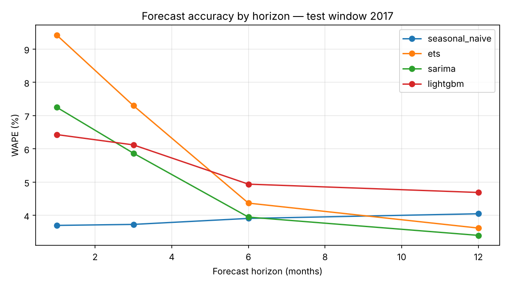

# Monthly demand forecasting by store × item: statistical vs. ML baselines

Portfolio project. One pipeline that aggregates daily sales to monthly demand, benchmarks four forecasting approaches on a 12-month hold-out, scores them with demand-planning metrics (WAPE, MAPE, bias, forecast value added), and turns the results into a planning recommendation: where to automate, where to plan by exception, where planner judgement stays.

**Data.** Kaggle *Store Item Demand Forecasting Challenge*: 10 stores × 50 items, daily sales 2013–2017 (913 000 rows), aggregated to 500 monthly series × 60 months. Train 2013–2016, test 2017.

## Results (test window 2017, all 500 series)

| Model | WAPE 1m | WAPE 3m | WAPE 6m | WAPE 12m | Bias 12m | FVA vs. naive, 12m |
|---|---|---|---|---|---|---|
| Seasonal naive (reference) | 3.70 | 3.73 | 3.91 | 4.05 | −3.5 % | — |
| ETS (Holt-Winters additive) | 9.42 | 7.30 | 4.37 | 3.62 | +1.9 % | +0.4 pts |
| SARIMA (1,1,1)(1,1,0)₁₂ | 7.25 | 5.87 | 3.95 | **3.40** | +2.2 % | **+0.6 pts** |
| LightGBM (global, lag + calendar features, recursive) | 6.43 | 6.12 | 4.94 | 4.69 | +4.3 % | −0.6 pts |

Bias is signed error as % of actual demand (+ = over-forecast). Full table: `model_scores.csv`; per-series results: `per_series_results.csv`.



## What the numbers say

1. **Short horizons: the naive reference wins.** Year-on-year growth slowed from 8.6 % (2016) to 3.6 % (2017). Every trend-following model extrapolated the earlier growth and over-forecast January–March 2017 by 6–9 %. Seasonal naive carries no trend and was only 2.4 % low. Lesson for planning: when growth decelerates, a strong statistical model is biased in a predictable direction and the planner should see that bias, not just the accuracy.
2. **Long horizons: SARIMA and ETS add value.** From six months out the seasonal models beat the reference; over the full year SARIMA is best on 252 of 500 series, ETS on 118, naive on 108, LightGBM on 22.
3. **The global ML model does not pay for itself here.** With only 48 training months per series and near-identical seasonality across the portfolio, lag features give LightGBM little that the statistical models do not already capture, and the recursive multi-step scheme compounds the early over-forecast. On a larger, more heterogeneous portfolio with external signals (promotions, pricing, market events) the picture usually changes; that is the experiment to run next.
4. **Segmentation.** This dataset is synthetic in character: all 500 series share the same seasonal shape and a coefficient of variation of 0.22. The segmentation step therefore puts every series in "automate" (median best WAPE 3.1 %). The code is written for real portfolios, where the same step separates stable high-volume products (automate), moderately erratic ones (plan by exception) and intermittent or launch products (planner judgement).

## Method

- **Hold-out:** last 12 months; accuracy reported at 1-, 3-, 6- and 12-month horizons so short-term replenishment and long-term capacity decisions are judged separately.
- **Metrics:** WAPE (volume-weighted, the planning standard), MAPE, bias, and forecast value added = WAPE(naive) − WAPE(model), in percentage points.
- **Models:** seasonal naive; Holt-Winters ETS with additive trend and seasonality; SARIMA (1,1,1)(1,1,0)₁₂; LightGBM global model with lags 1/2/3/6/12, rolling means 3/6/12, month-of-year, year, store and item as categorical features, forecasting recursively.
- **Selection rule:** best model per series by 12-month WAPE; recommendation by best WAPE and demand variability.

## Run it

```bash
pip install -r requirements.txt
# put the Kaggle train.csv in data/
python forecast.py
```

Runs in about five minutes on a laptop. Outputs: `model_scores.csv`, `per_series_results.csv`, `planning_recommendation.csv`, `wape_by_horizon.png`, `example_series.png`.

## Next steps

- Rolling-origin (time-series cross-validation) instead of a single hold-out.
- Direct multi-step LightGBM (one model per horizon) to stop error compounding.
- External demand signals and their predictive value; intermittent-demand models (Croston / TSB) for sparse series.
- Package as a scheduled job producing a monthly baseline with exception flags where bias exceeds a threshold.
